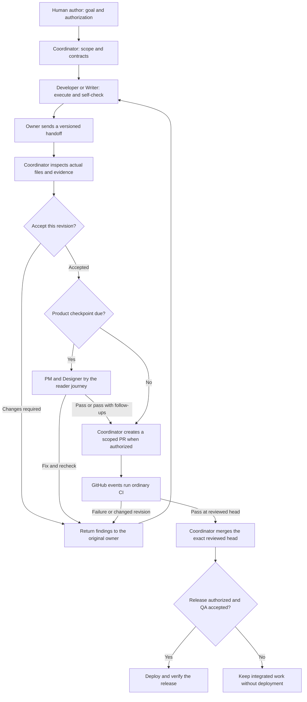

# Agent collaboration workflow

This is the sole detailed workflow for four project roles. Jason Zhang, the human author, sets reader needs, goals, material trade-offs and authorization, and remains the final authority. AI assists research, drafting, design, implementation and verification. [AGENTS](../AGENTS.md) is the short entry; role guides explain responsibilities; the [board](coordination.md) owns current assignments/holds/workspaces; handoffs own task/execution evidence; reviews own exact-revision judgments. History and archives preserve context, not active instructions.

## Roles and ownership

| Role | Responsibility | Boundary |
| --- | --- | --- |
| Product & Design Lead · Reader Experience | Product decisions, editorial reading experience, design and product desk checks | Advises the author and reviews the experience; Coordinator manages executors |
| Delivery Lead (Coordinator/Reviewer) | Architecture/contracts, assignments, inspection, feedback, status and Git integration | Does not substitute product code, prose or executor implementation explanations |
| Writer | Assigned research/outline, prose, examples, teaching diagrams and product/editorial explanations | Does not implement the website or self-accept manuscripts |
| Developer | Assigned website/tooling/tests and technical/process explanations | Does not rewrite Writer meaning/prose or self-accept implementation |

The product/design role combines PM and designer responsibilities. Coordinator acts as engineering manager for Writer and Developer and coordinates the integrated revision. Coordinator handles technical/source review. The implementer does not approve or merge its own deliverable.

Writer normally owns `book/` and teaching assets; Developer normally owns assigned `site/`, root tooling, `panda/`, `scripts/`, `tests/` and `.github/` files. Shared entry/design/contract/process documents require explicit file assignment; delegating writing does not delegate decision authority. Coordinator owns actual `docs/reviews/` records. Each executor owns its `docs/handoffs/<role>/` reports. Preserve existing ownership/changes; reading another owner's work is not permission to edit it. Return corrections to the original owner.

Concurrent work uses assigned workspaces with disjoint allowed files. A chat's default cwd does not follow assignments automatically: verify directory, branch, HEAD, status and relation to the assigned main baseline before editing. Do not switch/reset/stage to hide a mismatch. Worktrees separate working areas, not account permissions/confidentiality. Coordinator coordinates all Git writes; executors do not stage, commit, push or merge.

### Workspace and main checkout

The author's primary checkout stays on clean, current `main`. Each role performs assigned edits in a separate branch and worktree, including documentation and manuscript work. A chat opened at the author path must use its assigned working directory explicitly. Delivery alone updates the author checkout by fast-forwarding reviewed, merged changes; an unaccepted task branch does not enter main to clear the workspace.

Before moving existing work, stop its owners at a recoverable point, inventory tracked/untracked and necessary ignored files, and verify durable private archives/branches against those bytes. Preserve deletions as part of the user's change. Keep unpublished designs, comparison manuscripts and private handoffs outside the public main package; a temporary stash is not their sole recovery copy. Release an occupied main worktree only after checking its state and activity, without deleting it. Record exact role workspaces and recovery pointers in the current local handoff, not in public prose.

## Team startup

On the explicit team-start request in [AGENTS](../AGENTS.md), use the current chat as Coordinator. Inspect the accessible project chats for this repository and verify their actual roles. Reuse matching chats; create only the missing Product & Design Lead · Reader Experience, Writer and Developer chats. Do not create a second Coordinator. A resumed named-role chat keeps its own identity and does not recursively start another team.

Give each role the actual checkout, its role guide, the current board, its active brief or next review trigger, and its allowed scope. Confirm receipt and verified revision before marking a role active. Start the work already authorized on the board immediately. Roles without an actionable assignment report ready once. If the previous account or another checkout may still own the same task, verify the handoff before a second writer changes the same files. Check for locally referenced documents, uncommitted inputs and preview availability in the new checkout. Report exact missing inputs and continue independent authorized work.

If the client exposes only delegated agents, reuse the Coordinator plus three named agents for the active session and disclose their lifetime. If chat creation or delegation is unavailable, report which roles could actually be started. Keep account-specific IDs out of the repository. Opening a checkout supplies instructions to a running session; it does not start a background service.

## Product desk check

Review when a complete reader journey becomes usable and once end to end at milestone close. Bring forward a check when a single change affects edition switching, saved position, access to the text or claims about available content. Bundle documentation and internal housekeeping into the next update. If the last journey check covers the complete milestone on the same revision, reuse its evidence.

1. Writer and Developer update their existing handoffs. Delivery Lead sends **one** request to the existing Product & Design Lead · Reader Experience chat with the reader outcome, preview and exact revision, main journey, edge case, completed checks and untested environments. Include the Figma frame when the design changed.
2. Product & Design Lead · Reader Experience tries the paths as a reader and returns **Pass**, **Pass with follow-ups**, or **Fix and recheck**. If the preview is missing or different, record **Pending evidence** and the needed input. Capture the screen or step, impact, expected experience and whether it blocks acceptance. Put optional improvements on the roadmap for consideration.
3. Coordinator records the product verdict separately from technical acceptance in the existing review, routes fixes to their original owner and requests a focused product recheck. A reader-visible slice closes after both relevant judgments are recorded. Unrelated authorized work can continue. Keep the human reader trial separate.

## Workflow overview

This diagram summarizes the detailed rules below. Explicit assignments and current holds still govern every continuation, including integration and deployment.

## Assignment and lifecycle

Coordinator specifies task, owner, goal, inputs, allowed files, workspace/branch, deliverable, acceptance, dependencies and next authorized boundary. A roadmap, proposal or message receipt is not an assignment. The owner starts one report using the [task brief/handoff template](handoffs/TEMPLATE.md) at assignment, before execution, then appends results/revisions. The board links the brief and summarizes current state only.

The lifecycle is **Assigned → In progress → In review → Changes requested or Accepted → Merged**. Changes requested returns to the original owner, then In review. Accepted is distinct from Merged: authorized integration may still be pending. Merged needs actual Git evidence; a verified already-integrated branch can close without an artificial PR. Deployment is separate, not the implied next state.

**Paused** and **Blocked** are independent holds on the recorded lifecycle state. Record affected scope, reason, responsible party and resume condition. A product hold can coexist with an explicit documentation assignment. No task means ask Coordinator for scope; a hold means preserve recovery and await its stated resolution. Silence, elapsed time and a resumed chat do not lift a hold. Coordinator resolves conflicts; the parent Coordinator owns closure rather than leaving an executor to invent work.

At startup, read AGENTS → explicitly assigned role guide → board → task brief and necessary inputs. Verify the tree and send one brief with role/task, workspace/revision/status, next scoped action and conflicts. This is information, not another approval gate: continue clear authorized work directly. The caller supplies role/path/chat identity; do not guess or claim every tool loads these files automatically. Full history/archive reading is not required.

## Execution, review and revision

1. Execute only the assigned scope with proportionate checks. Preserve others' work; report missing evidence/limits rather than expanding scope.
2. Append actual paths, results, checks, open questions and recovery to the same handoff. Freeze reviewable files; send Coordinator the path, revision, short scope and open items directly.
3. Coordinator reads actual files/evidence, verifies as needed and records exact revision, findings and **Accepted**, **Changes requested** or **Insufficient evidence** using the [review format](reviews/TEMPLATE.md). Insufficient evidence leaves In review, or returns a specific evidence request to its owner; it is not acceptance.
4. Return findings with location, impact, owner and criterion. The original owner revises, updates the same handoff and resubmits. Coordinator rechecks affected work, records closure and preserves history. Changed work does not inherit old acceptance.
5. After acceptance, Coordinator closes executor tasks or releases only an already authorized next step. Remaining PR/check/merge work is integration, not an instruction to keep editing accepted files. Holds on other scopes remain effective.

Writer's [chapter workflow](../book/planning/chapter-workflow.md) requires analysis/research, detailed outline, examples, evidence boundaries and validation plans first. Accepted analysis plus assigned writing scope precedes prose; manuscripts have a separate review and distinct agreed identifier. Analysis is a document, not another agent. Ordinary wording edits need no new analysis gate; substantive mechanism/evidence/scope changes return to the relevant gate.

## Content, language and evidence

Writer owns the canonical manuscript and diagram meaning. Developer follows the accepted [content contract](content-contract.md) when integration is assigned, without copying bodies into JSX, recursively publishing drafts or inferring translation. Rendering/responsiveness/text alternatives belong to Developer; meaning/example corrections return to Writer. Reviewed drafts, merged sources and publicly rendered chapters are distinct outcomes.

Formal technical/product/process explanations and active code/design comments are English-first. Answer in the user's language; temporary/secondary handoffs may be Chinese. The bilingual book retains Chinese-first manuscript review before English adaptation. Explain mechanisms concretely; distinguish documented behavior, experiments, experience, assumptions and recommendations. Verify volatile claims with primary sources when authorized, respect licenses/attribution and do not invent measurements, sources or experience.

## Messages, records and recovery

The user authorizes direct assignment/handoff/feedback/revision messages among the existing four project-role chats for authorized work. Send paths and useful summaries; no user relay or repeated receipt loop is needed. Chats do not automatically share histories or continuously monitor files. Report failed delivery. Receipt, acknowledgment, silence and timing are not approval.

Use readable outcome names with legacy IDs for traceability. Keep one handoff per meaningful stage, not per feedback paragraph. The board is the only live state summary; do not duplicate its queue/workspaces in stable guides. Reviews record judgment rather than copying full task briefs. Accepted decisions belong in formal sources; private transcripts, conversation identifiers, credentials and unnecessary personal details stay out of this public repository.

Before interruption, append done/not done, uncommitted work, last checks/limits, last reviewed revision, open findings, next action and resume condition to the handoff. Keep enough durable detail to recover without temporary logs or ignored notes. On recovery, reread board/brief/review and verify actual tree/status. Follow the [document/notes policy](agent-notes-policy.md); scratch notes are optional, neither formal sources nor secret storage.

## Git integration and publication

Start new iterations from current remote `main`, with Coordinator coordinating branch/worktree changes. Within applicable user authorization, Coordinator creates a scoped PR after local review, verifies matching reviewed head and successful required checks, then uses permitted squash merge. New commits need affected re-review and their own required checks. Respect protection; never weaken it to finish. Already authorized integration needs no repeated routine confirmation.

Record actual PR/head, acceptance, cloud checks, squash merge and deployment separately; a PR head is not its squash commit. Verify already-equal/included branches rather than manufacture PRs or rewrite history. Access baselines are dated evidence, not permanent guarantees; follow [SECURITY](../SECURITY.md) and [access policy](security/access-policy.md), rechecking live settings when relevant. Installation, external calls, expanded scope, access changes and publication need applicable user authorization. Review/merge does not authorize release or override a current hold.
